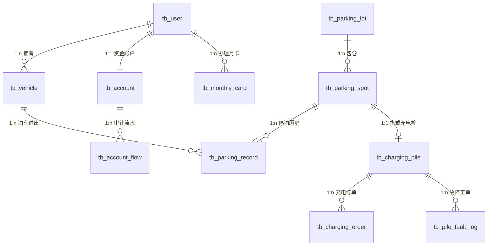

# 《“智行悦泊”智慧园区停车与新能源充电综合管理系统》课程项目任务书

* **课程名称**：《Java面向对象程序设计》
* **项目名称**：“智行悦泊”智慧园区停车与新能源充电综合管理系统（Java SE + MySQL版）
* **适用对象**：计算机应用技术专业学生
* **考核性质**：课程期末综合大作业 / 第9周实训项目
* **完成形式**：个人独立完成 或 2 人合作小组（需在设计报告扉页注明各自任务分工与贡献比例）
* **开发环境要求**：
  * 操作系统：Windows 10 / 11 64位
  * 开发工具：IntelliJ IDEA 2023+
  * JDK 版本：JDK 8 或 JDK 21
  * 数据库版本：MySQL Community Server 8.0.x（强制编码：`utf8mb4`）
  * 数据库驱动：`mysql-connector-j-9.5.0.jar`
  * 架构规范：标准三层架构（View/Controller - Service - DAO - DB）

---

## 一、 项目背景与业务全景描述

### 1. 业务背景
随着智慧园区建设与新能源汽车（EV）的全面普及，传统停车管理面临“车位周转率低、油车盲目占充电桩、离场排队缴费拥堵、峰谷电价精算复杂、充电桩故障无感知”等突出痛点。“智行悦泊”综合管理系统旨在打通**“车辆入场识别、车位智能调度、车辆离场阶梯扣费、新能源充电分时结算、充电桩故障告警与运维”**全业务流，为园区构建数据互联、资产透明、事务安全的数字化运营管理系统。

### 2. 核心用户角色（3+1类主体）
1. **园区业主与常驻车主（Owner）**：绑定固定车辆、办理并续费月卡、查询名下月卡生效状态、预约专属车位。
2. **临停车主与访客（Visitor Driver）**：绑定车牌、实时查询空闲车位/充电桩、在线充值钱包、入场扫码泊车、离场无感扣费。
3. **充电桩运维技师（Technician）**：接收充电桩故障报警工单、现场排查检修、录入维修记录并恢复充电桩上线。
4. **园区物业运营管理员（Admin）**：统一调控车位与充电桩状态、排查欠费与超时占位车辆、监控园区资金审计黑匣子、导出每日经营营收总台账。

---

## 二、 完整的 MySQL 数据库系统设计规格说明

本系统数据库强制命名为：**`zhixingyuebo_db`**，必须严格采用 **`utf8mb4`** 字符集与 **`utf8mb4_general_ci`** 排序规则。系统共设计 **10 张核心业务表**：



### 1. 数据类型设计“四大军规”
1. **金额与电量精算天条**：凡涉及钱包余额、充值金额、停车阶梯费率、电价、充电度数（kWh）、实付金额的列，**必须且只能使用 `DECIMAL(10,2)` 或 `DECIMAL(8,2)`，严禁使用 FLOAT 或 DOUBLE**；
2. **车牌与手机号固定长度**：中国大陆机动车车牌统一采用 `VARCHAR(10)`（预留新能源8位及常规7位）；手机号固定采用 `CHAR(11)` 并建立唯一索引；
3. **原生时间存储**：所有入场出场、开始充电、操作流水均采用原生 `DATETIME`，严禁使用字符串存时间；
4. **软删除支持**：用户、车辆、车位、充电桩主数据必须包含 `is_deleted TINYINT NOT NULL DEFAULT 0`。

---

### 2. 全套 10 张核心业务表数据字典

#### 表 1：用户基本信息表（`tb_user`）
* **说明**：记录车主、技师与管理员基本信息。

| 字段名 | 数据类型 | 允许NULL | 键/约束 | 默认值 | 字段说明 |
| :--- | :--- | :---: | :---: | :--- | :--- |
| `user_id` | `INT UNSIGNED` | 否 | **PK 自增** | | 用户唯一编码 |
| `username` | `VARCHAR(30)` | 否 | | | 真实姓名/昵称 |
| `phone` | `CHAR(11)` | 否 | **UNIQUE** | | 11位手机号码（登录唯一凭据） |
| `user_type` | `TINYINT UNSIGNED` | 否 | | `1` | 角色（1普通车主, 2运维技师, 3物业管理员） |
| `created_at` | `DATETIME` | 否 | | `CURRENT_TIMESTAMP` | 账号注册时间 |
| `is_deleted` | `TINYINT UNSIGNED` | 否 | | `0` | 软删除标记（0正常, 1已注销） |

#### 表 2：机动车车辆档案表（`tb_vehicle`）
* **说明**：登记入驻园区的机动车信息（1:n 归属用户）。

| 字段名 | 数据类型 | 允许NULL | 键/约束 | 默认值 | 字段说明 |
| :--- | :--- | :---: | :---: | :--- | :--- |
| `vehicle_id` | `INT UNSIGNED` | 否 | **PK 自增** | | 车辆内部编号 |
| `user_id` | `INT UNSIGNED` | 否 | **FK 外键** | | 归属车主ID，关联 `tb_user.user_id` |
| `plate_number`| `VARCHAR(10)` | 否 | **UNIQUE** | | 车牌号码（如：川A88888、川AD12345） |
| `vehicle_type`| `TINYINT UNSIGNED` | 否 | | `1` | 车型（1燃油轿车, 2新能源纯电, 3新能源插混, 4大型货车） |
| `brand` | `VARCHAR(30)` | 否 | | `''` | 车辆品牌型号（如：比亚迪汉、特斯拉Model Y） |
| `is_deleted` | `TINYINT UNSIGNED` | 否 | | `0` | 软删除（0在册, 1解绑） |

#### 表 3：园区停车场区域表（`tb_parking_lot`）
* **说明**：记录地下车库、地面园区等区域划分。

| 字段名 | 数据类型 | 允许NULL | 键/约束 | 默认值 | 字段说明 |
| :--- | :--- | :---: | :---: | :--- | :--- |
| `lot_id` | `INT UNSIGNED` | 否 | **PK 自增** | | 区域编号 |
| `lot_name` | `VARCHAR(50)` | 否 | | | 停车场名称（如：A区地下负一层、B区南门地面停车场） |
| `total_capacity`| `SMALLINT UNSIGNED`| 否 | | `100` | 规划总车位数 |
| `hourly_rate` | `DECIMAL(6,2)` | 否 | | `4.00` | 临停标准费率（元/小时，前30分钟免费） |

#### 表 4：车位基础信息表（`tb_parking_spot`）
* **说明**：具体车位单元信息。

| 字段名 | 数据类型 | 允许NULL | 键/约束 | 默认值 | 字段说明 |
| :--- | :--- | :---: | :---: | :--- | :--- |
| `spot_id` | `INT UNSIGNED` | 否 | **PK 自增** | | 车位唯一编号 |
| `lot_id` | `INT UNSIGNED` | 否 | **FK 外键** | | 所属区域ID，关联 `tb_parking_lot.lot_id` |
| `spot_number` | `VARCHAR(20)` | 否 | **UNIQUE** | | 车位物理编码（如：A-0101、B-0205） |
| `spot_type` | `TINYINT UNSIGNED` | 否 | | `1` | 车位属性（1普通车位, 2新能源充电专用位, 3无障碍VIP位） |
| `spot_status` | `TINYINT UNSIGNED` | 否 | | `0` | 当前占用状态（0空闲, 1已被预约, 2车辆已泊入, 3维护禁用） |
| `is_deleted` | `TINYINT UNSIGNED` | 否 | | `0` | 报废软删除 |

#### 表 5：新能源智能充电桩表（`tb_charging_pile`）
* **说明**：安装在充电专用车位上的智能充电硬件设备。

| 字段名 | 数据类型 | 允许NULL | 键/约束 | 默认值 | 字段说明 |
| :--- | :--- | :---: | :---: | :--- | :--- |
| `pile_id` | `INT UNSIGNED` | 否 | **PK 自增** | | 充电桩资产编号 |
| `spot_id` | `INT UNSIGNED` | 否 | **UNIQUE / FK**| | 绑定车位ID，关联 `tb_parking_spot.spot_id`（1:1） |
| `pile_code` | `VARCHAR(32)` | 否 | **UNIQUE** | | 充电桩设备唯一出厂条码编号 |
| `power_kw` | `DECIMAL(5,1)` | 否 | | `7.0` | 额定功率（kW，如：7.0慢充、120.0快充） |
| `price_per_kwh`| `DECIMAL(6,2)` | 否 | | `1.20` | 综合电价费率（元/度，含电费+服务费） |
| `pile_status` | `TINYINT UNSIGNED` | 否 | | `1` | 硬件状态（1空闲就绪, 2正在充电, 3故障报警, 4离线检修） |

#### 表 6：停车进出场与计费记录主表（`tb_parking_record`）
* **说明**：车辆泊车流转与费用核算主表。

| 字段名 | 数据类型 | 允许NULL | 键/约束 | 默认值 | 字段说明 |
| :--- | :--- | :---: | :---: | :--- | :--- |
| `record_id` | `BIGINT UNSIGNED` | 否 | **PK 自增** | | 停车单流水号 |
| `vehicle_id` | `INT UNSIGNED` | 否 | **FK 外键** | | 停泊车辆ID，关联 `tb_vehicle.vehicle_id` |
| `spot_id` | `INT UNSIGNED` | 否 | **FK 外键** | | 占用车位ID，关联 `tb_parking_spot.spot_id` |
| `entry_time` | `DATETIME` | 否 | | `CURRENT_TIMESTAMP` | 车辆道闸入场时刻 |
| `exit_time` | `DATETIME` | 是 | | `NULL` | 车辆离场道闸放行时刻（未离场为NULL） |
| `park_minutes`| `INT UNSIGNED` | 是 | | `0` | 累计停泊总分钟数 |
| `total_fee` | `DECIMAL(8,2)` | 否 | | `0.00` | 应收停车总费（元） |
| `pay_status` | `TINYINT UNSIGNED` | 否 | | `0` | 结算状态（0未结算/在场, 1月卡全免, 2钱包成功扣款, 3已补缴出场） |

#### 表 7：新能源汽车充电工单表（`tb_charging_order`）
* **说明**：充电桩使用计量与费用结算明细表。

| 字段名 | 数据类型 | 允许NULL | 键/约束 | 默认值 | 字段说明 |
| :--- | :--- | :---: | :---: | :--- | :--- |
| `order_id` | `BIGINT UNSIGNED` | 否 | **PK 自增** | | 充电订单号 |
| `pile_id` | `INT UNSIGNED` | 否 | **FK 外键** | | 使用充电桩ID，关联 `tb_charging_pile.pile_id` |
| `user_id` | `INT UNSIGNED` | 否 | **FK 外键** | | 充电车主ID，关联 `tb_user.user_id` |
| `plate_number`| `VARCHAR(10)` | 否 | | | 充电车牌号 |
| `start_time` | `DATETIME` | 否 | | `CURRENT_TIMESTAMP` | 开始插枪启动充电时刻 |
| `end_time` | `DATETIME` | 是 | | `NULL` | 充电结束/拔枪时刻 |
| `kwh_amount` | `DECIMAL(6,2)` | 否 | | `0.00` | 累计充入电量（度/kWh） |
| `total_cost` | `DECIMAL(8,2)` | 否 | | `0.00` | 充电实付总金额（`kwh_amount * price_per_kwh`） |
| `order_status`| `TINYINT UNSIGNED` | 否 | | `0` | 状态（0充电中, 1已结算完成, 2异常中断待处理） |

#### 表 8：充电桩故障与告警工单表（`tb_pile_fault_log`）
* **说明**：充电桩突发故障或过载上报与维修闭环表。

| 字段名 | 数据类型 | 允许NULL | 键/约束 | 默认值 | 字段说明 |
| :--- | :--- | :---: | :---: | :--- | :--- |
| `fault_id` | `BIGINT UNSIGNED` | 否 | **PK 自增** | | 故障报警流水号 |
| `pile_id` | `INT UNSIGNED` | 否 | **FK 外键** | | 故障设备ID，关联 `tb_charging_pile.pile_id` |
| `error_code` | `VARCHAR(20)` | 否 | | `'E01'` | 故障代码（E01过温过载, E02短路接地, E03通讯中断, E04枪头锁死） |
| `fault_desc` | `VARCHAR(200)` | 否 | | | 故障现象描述 |
| `reported_at` | `DATETIME` | 否 | | `CURRENT_TIMESTAMP` | 故障触发上报时刻 |
| `technician_id`| `INT UNSIGNED` | 是 | **FK 外键** | `NULL` | 接单检修技师ID，关联 `tb_user.user_id` |
| `resolve_note`| `VARCHAR(200)` | 是 | | `NULL` | 技师检修排除记录 |
| `fault_status`| `TINYINT UNSIGNED` | 否 | | `0` | 状态（0待接单, 1排查维修中, 2已修复恢复上线） |

#### 表 9：车主虚拟钱包账户主表（`tb_account`）
* **说明**：车主资金结算核心账户（与 `tb_user` 严格 1:1 绑定）。

| 字段名 | 数据类型 | 允许NULL | 键/约束 | 默认值 | 字段说明 |
| :--- | :--- | :---: | :---: | :--- | :--- |
| `account_id` | `INT UNSIGNED` | 否 | **PK (等于user_id)** | | 账户ID，取值与 `user_id` 严格对应 |
| `balance` | `DECIMAL(10,2)` | 否 | | `0.00` | 可用资金余额（元） |
| `frozen_money`| `DECIMAL(10,2)` | 否 | | `0.00` | 预约车位/正在充电锁定押金（元） |
| `updated_at` | `DATETIME` | 否 | | `CURRENT_TIMESTAMP` | 资金变动入账时刻 |

#### 表 10：资金变动只读审计流水表（`tb_account_flow`）
* **说明**：防篡改金融级资金变动流水表（只允许 INSERT，严禁 UPDATE/DELETE）。

| 字段名 | 数据类型 | 允许NULL | 键/约束 | 默认值 | 字段说明 |
| :--- | :--- | :---: | :---: | :--- | :--- |
| `flow_id` | `BIGINT UNSIGNED` | 否 | **PK 自增** | | 流水号 |
| `account_id` | `INT UNSIGNED` | 否 | **KEY 索引** | | 关联钱包账户ID |
| `before_balance`| `DECIMAL(10,2)` | 否 | | `0.00` | 变动前原余额 |
| `after_balance` | `DECIMAL(10,2)` | 否 | | `0.00` | 变动后最新余额 |
| `diff_amount` | `DECIMAL(10,2)` | 否 | | `0.00` | 本次变动差额（正为充值，负为扣款） |
| `biz_type` | `VARCHAR(30)` | 否 | | | 业务类型（停车扣费/充电扣款/账户充值/违规滞纳金） |
| `created_at` | `DATETIME` | 否 | | `CURRENT_TIMESTAMP` | 流水产生时刻 |

---

## 三、 五大【必做】核心业务模块设计

系统严格采用 **View/Controller - Service - DAO** 三层架构，两名组员必须协同完成以下 5 大核心业务闭环：

### 模块一：多角色认证鉴权与车辆资产绑定（考查：继承、多态、抽象类、封装）
* **核心业务**：
  * **抽象用户基类与多态工作台**：定义抽象类 `User`，派生 `OwnerDriver`（车主）、`Technician`（技师）、`Admin`（管理员），重写 `showMenu()` 多态展示专属控制台；
  * **车辆档案多车绑定**：车主支持绑定多辆私家车（1:n），并校验车牌格式正则表达式；
  * **钱包账户与充值管理**：初始化 `tb_account`，提供充值入口，更新钱包余额并原子写入 `tb_account_flow` 审计流水。

### 模块二：智慧车位实时检索与泊车入场预约（考查：状态模式、集合框架、多条件检索）
* **核心业务**：
  * **智能车位大盘与筛选**：支持按“普通车位 / 新能源充电专用位”、区域进行空闲筛选（`spot_status = 0`）；
  * **车位提前预约锁定**：车主线上选定车位，系统将车位状态翻转为“已预约”（`spot_status = 1`），锁定押金或记录预约有效期；
  * **道闸模拟入场登记**：车辆驶入道闸，校验车牌与车位对应关系，生成 `tb_parking_record` 入场记录，车位状态正式更新为“已泊入”（`spot_status = 2`）。

### 模块三：离场阶梯精算与自动扣款事务（核心事务一）（考查：JDBC手动事务、BigDecimal计算、自定义异常）
* **核心业务**：
  * **阶梯停车计费引擎**：
    * 停车 $\le 30$ 分钟：免收停车费；
    * 超过 30 分钟：按小时标准费率计费（不足 1 小时按 1 小时精算，每日 50 元封顶）；
    * 拥有生效月卡的车主：应付金额直接置为 0.00 元。
  * **原子化离场结算闭环（JDBC事务）**：
    1. 校验车主钱包余额，若余额不足抛出自定义受检异常 `InsufficientBalanceException`；
    2. **开启事务（`conn.setAutoCommit(false)`）**：
       * 扣减车主钱包可用余额；
       * 将对应车位状态安全释放为“空闲”（`spot_status = 0`）；
       * 回填 `tb_parking_record` 的出场时刻、总时长与实收总额；
       * 写入资金审计黑匣子流水 `tb_account_flow`。
    3. 统一 `commit()`，任何异常全盘回滚并拒绝抬杆放行。

### 模块四：新能源充电桩预约、分时计费与电费结算（核心事务二）（考查：JDBC手动事务、硬件状态流转）
* **核心业务**：
  * **专用充电桩插枪启动**：新能源车辆驶入充电专用位，选定处于“空闲就绪”（`pile_status = 1`）的充电桩，启动充电；充电桩硬件状态翻转为“正在充电”（`pile_status = 2`）；
  * **充电工单生成与电量计量**：插入一条状态为进行中的 `tb_charging_order` 工单；
  * **拔枪结算原子事务**：
    1. 计算充入电量（kWh）及充电总费用（`kwh_amount * price_per_kwh`）；
    2. 开启 JDBC 事务：扣减车主钱包、充电工单状态归档、充电桩硬件恢复空闲；
    3. 控制台打印格式化“新能源充电消费电子结算发票”。

### 模块五：充电桩突发故障报警与自动报修工单闭环（考查：工单状态机、空值安全、规则引擎）
* **核心业务**：
  * **故障触发与自动熔断**：当充电桩检测到过温或短路（错误码 E01~E04）时，系统自动将充电桩标记为“故障报警”（`pile_status = 3`），并立即在 `tb_pile_fault_log` 生成一条待处理报警工单（`technician_id IS NULL`）；
  * **运维技师在线接单排查**：运维技师登录系统，一键查询待处理报警工单并执行“认领接单”，工单状态置为“排查维修中”；
  * **消警上线与闭环验证**：技师录入检修处置措施（`resolve_note`），提交后系统自动将工单标记为“已修复”，并将充电桩状态重新恢复上线为“空闲就绪”（`pile_status = 1`）。

---

## 四、 【必做】创新模块（三选一或自主发挥，占创新分 20%）

学生小组必须在以下创新方向中至少选择一项落地（或自主发挥）：

* **创新 A：IoT 智能充电桩多线程功率与电量采集模拟器（考查：多线程 Thread / Runnable）**
  * 编写后台守护线程 `ChargingSimulatorThread`，模拟插枪充电过程：每隔 2 秒递增上报当前充电电量（+2.5 kWh）与实时功率，控制台动态刷新充电进度条（如：`[=======>   ] 70%`）；当达到预设目标或充满时自动触发断电并调用结算服务。
* **创新 B：园区每日车流吞吐高峰与财务营收 CSV 报表导出（考查：Java 文件 I/O 缓冲流）**
  * 编写报表服务，对指定日期的停车收费总额、充电度数总额、各区域车位周转率进行分组统计，通过 `BufferedWriter` 格式化导出为标准 `.csv` 文件，支持 Excel 双击打开查看。
* **创新 C：自由发挥创新项**
  * 例如：基于 Java Swing / JavaFX 构建图形化车位模拟大盘（红绿灯显示占用/空闲）；或实现短信道闸抬杆指令模拟器。

---

## 五、 标准工程目录结构与分层规范要求

为保障工程的工业级分层规范性、团队协作效率以及评分标准的可验证性，项目必须严格遵循**标准三层架构（View/Controller - Service - DAO - DB）**规范组织代码与工程目录。**严禁在 DAO 中编写业务判断逻辑，严禁在 View 中直接调用 DAO 或拼接执行 SQL 语句**。

### 1. 标准工程目录与包结构全景图

```text
zhixingyuebo-java/
├── lib/
│   └── mysql-connector-j-9.5.0.jar            # MySQL 8.0+ 官方 JDBC 数据库驱动
├── resources/
│   └── db.properties                          # 数据库连接配置文件 (Driver, URL, 用户名, 密码)
└── src/
    └── com/zhixingyuebo/
        ├── entity/                            # 领域实体对象层（POJO，与数据库 10 张物理表严格映射）
        │   ├── User.java                      # 抽象用户基类（定义工号/ID、姓名、手机号、角色类型及抽象方法 showMenu()）
        │   ├── OwnerDriver.java               # 园区车主实体（继承 User，重写 showMenu() 打印车主专属菜单）
        │   ├── Technician.java                # 充电桩运维技师实体（继承 User，重写 showMenu() 打印抢单维修菜单）
        │   ├── Admin.java                     # 物业运营管理员实体（继承 User，重写 showMenu() 打印全局监控菜单）
        │   ├── Vehicle.java                   # 机动车车辆档案实体（对应 tb_vehicle）
        │   ├── ParkingLot.java                # 停车场区域信息实体（对应 tb_parking_lot）
        │   ├── ParkingSpot.java               # 车位基础单元实体（对应 tb_parking_spot）
        │   ├── ChargingPile.java              # 智能充电桩设备实体（对应 tb_charging_pile）
        │   ├── ParkingRecord.java             # 停车泊车与出入场计费记录实体（对应 tb_parking_record）
        │   ├── ChargingOrder.java             # 新能源汽车充电工单实体（对应 tb_charging_order）
        │   ├── PileFaultLog.java              # 充电桩故障与告警工单实体（对应 tb_pile_fault_log）
        │   ├── Account.java                   # 车主虚拟钱包账户实体（对应 tb_account）
        │   └── AccountFlow.java               # 资金变动只读审计流水实体（对应 tb_account_flow）
        ├── dao/                               # 数据访问层接口（DAO Interface，纯粹的 CRUD 契约）
        │   ├── BaseDao.java                   # 通用泛型 DAO 基础接口（定义 CRUD 规范）
        │   ├── UserDao.java                   # 用户认证与信息数据访问接口
        │   ├── VehicleDao.java                # 机动车档案增删改查与车牌唯一性检索接口
        │   ├── ParkingLotDao.java             # 停车场区域信息检索接口
        │   ├── ParkingSpotDao.java            # 车位大盘查询、状态翻转与锁定接口
        │   ├── ChargingPileDao.java           # 充电桩硬件设备状态流转与电价检索接口
        │   ├── ParkingRecordDao.java          # 泊车进场登记、离场计费与出场回填接口
        │   ├── ChargingOrderDao.java          # 充电工单创建、计量更新与结算归档接口
        │   ├── PileFaultLogDao.java           # 故障告警流水录入、技师接单与消警记录回填接口
        │   ├── AccountDao.java                # 钱包余额查询、可用余额扣减与充值接口
        │   └── AccountFlowDao.java            # 资金变动防篡改流水单向插入接口
        ├── dao/impl/                          # 数据访问层实现类（纯 JDBC 实现，参数化防注入）
        │   ├── UserDaoImpl.java
        │   ├── VehicleDaoImpl.java
        │   ├── ParkingLotDaoImpl.java
        │   ├── ParkingSpotDaoImpl.java
        │   ├── ChargingPileDaoImpl.java
        │   ├── ParkingRecordDaoImpl.java
        │   ├── ChargingOrderDaoImpl.java
        │   ├── PileFaultLogDaoImpl.java
        │   ├── AccountDaoImpl.java
        │   └── AccountFlowDaoImpl.java
        ├── service/                           # 业务逻辑层接口（Service Interface，业务用例契约）
        │   ├── UserService.java               # 手机号登录认证、名下车辆绑定业务接口
        │   ├── ParkingService.java            # 车位检索预约、道闸入场、离场阶梯算费与扣款事务接口（核心事务一）
        │   ├── ChargingService.java           # 充电桩插枪启动、工单流转、拔枪分时计费与电费结算事务接口（核心事务二）
        │   ├── FaultService.java              # 突发故障报警触发、技师认领排障、消警恢复上线业务接口
        │   └── AccountService.java            # 钱包账户查询、模拟充值与资金对账流水业务接口
        ├── service/impl/                      # 业务逻辑层实现类（核心业务逻辑与手动事务控制）
        │   ├── UserServiceImpl.java
        │   ├── ParkingServiceImpl.java        # 离场扣款原子事务落地（扣减钱包 + 释放车位 + 回填单据 + 写入流水）
        │   ├── ChargingServiceImpl.java       # 充电结算原子事务落地（核算电费 + 扣减钱包 + 归档工单 + 设备复位）
        │   ├── FaultServiceImpl.java
        │   └── AccountServiceImpl.java
        ├── exception/                         # 自定义业务异常体系（业务解耦与防御性容错）
        │   ├── ZhiXingYueBoException.java     # 系统业务根受检/运行时异常
        │   ├── InsufficientBalanceException.java # 钱包可用余额不足受检异常（阻断抬杆/拔枪结算）
        │   ├── SpotNotAvailableException.java # 车位已被预约/已被占用冲突异常
        │   ├── PileFaultException.java        # 充电桩硬件故障/离线不可用异常
        │   └── InvalidPlateNumberException.java # 车牌号码格式校验不合规异常
        ├── util/                              # 核心基础设施与工程工具类
        │   ├── DBUtil.java                    # 数据库驱动加载、ThreadLocal 事务连接绑定与安全资源释放
        │   ├── FormatUtil.java                # 控制台终端表格美化对齐、小票与消费账单格式化输出
        │   ├── DateUtil.java                  # 原生时间折算与停车分钟数/小时阶梯核算工具
        │   └── CsvExportUtil.java             # 创新 B：车流吞吐与园区财务台账 CSV 导出工具（缓冲 I/O 流）
        ├── thread/                            # 创新模块：并发多线程调度包（创新 A）
        │   └── ChargingSimulatorThread.java   # IoT 智能充电桩多线程功率与电量采集模拟器（守护线程/进度条）
        └── view/                              # 展现交互层（Console UI 控制台交互与路由）
            ├── MainApp.java                   # 应用程序主运行入口 main()
            ├── ConsoleMenu.java               # 交互菜单分发路由、多角色控制台与异常输入兜底处理
            └── TicketPrinter.java             # 停车离场小票与新能源充电消费结算电子发票终端打印
```

### 2. 标准三层架构分层职责与调用约束

系统必须严格遵循单向依赖调用链：**View → Service → DAO → MySQL Database**，各层职责边界划分如下：

* **表现层（View）**：
  * **核心职责**：负责控制台菜单展示、收集用户输入、调用 Service 层业务方法，并将结果格式化展示给用户；
  * **约束底线**：**严禁直接调用 DAO 层**；**严禁包含任何 SQL 语句或 JDBC API**；必须对用户输入的异常类型（如字符、特殊符号、越界数字）进行捕获兜底，禁止程序闪退。
* **业务逻辑层（Service）**：
  * **核心职责**：实现系统的核心业务规则（如阶梯停车计费算法、分时电价换算、余额充分性校验等）；**负责管控跨 DAO 操作的 JDBC 手动事务**（`conn.setAutoCommit(false)`、`conn.commit()`、`conn.rollback()`），确保业务操作原子性；抛出自定义业务异常；
  * **约束底线**：严禁在 Service 层直接编写 SQL 语句，所有数据持久化操作必须委托给 DAO 接口；严禁将底层 `SQLException` 裸露直接抛给用户终端。
* **数据访问层（DAO）**：
  * **核心职责**：面向接口编程，实现对 `zhixingyuebo_db` 数据库中特定数据表的 CRUD 操作；负责执行参数化 SQL 并将 `ResultSet` 结果集映射封装为 Entity 实体对象；
  * **约束底线**：**纯粹执行 SQL，严禁编写任何业务逻辑与金额判断**（例如：严禁在 DAO 中计算是否打折、严禁在 DAO 中核算停车时长与费率）；对于参与事务的操作，必须支持复用外部传入的同一 `Connection`（或利用 `DBUtil` 绑定的当前线程连接）。
* **实体模型层（Entity / POJO）**：
  * **核心职责**：与数据库 10 张物理表建立属性一对一映射，封装业务领域数据；
  * **约束底线**：遵循 JavaBean 规范，属性全部私有化（`private`），提供公共 Getter/Setter、无参构造与全参构造，重写 `toString()`；**金额与电量属性必须为 `BigDecimal`，严禁使用 `float` / `double`**。
* **工具与异常层（Util / Exception）**：
  * **核心职责**：`DBUtil` 统一提供数据库连接管理，通过 `ThreadLocal<Connection>` 支持单线程事务上下文绑定；自定义异常类建立清晰的继承体系，向表现层传递具有业务语义的错误描述。

---

## 六、 核心技术标准与编码“六大高压线”

在代码实现与评审答辩过程中，学生必须严格遵守以下六大技术规范。违反任何一条“高压线”，在考核量规对应项中将执行**一票否决或大幅扣分**：

1. **类型精度天条（严禁浮点类型存金额与电量）**：
   * 凡涉及钱包余额（`balance`）、充值金额、停车小时费率（`hourly_rate`）、电价（`price_per_kwh`）、充电度数（`kwh_amount`）、停车总费用（`total_fee`）、实付电费（`total_cost`）的变量，**Java 中必须且只能使用 `java.math.BigDecimal`**；
   * 涉及除法运算（如换算平均单价）必须显式指定保留 2 位小数及舍入模式（如 `RoundingMode.HALF_UP`），严禁使用 `float` 或 `double` 产生截断精度丢失问题。
2. **防 SQL 注入天条（强制占位符参数化）**：
   * 所有针对数据库的增删改查操作，**一律强制采用 `PreparedStatement` 配合 `?` 占位符赋值**；
   * 严禁采用字符串拼接（如 `"... WHERE phone = '" + phone + "'"`）构造 SQL，发现一处 SQL 注入漏洞直接扣除该模块代码全部质量分。
3. **架构分层穿透禁止（严格按层依赖）**：
   * 严禁 View 层绕过 Service 层直接依赖并调用 DAO 类；
   * 严禁在 View 层直接执行 JDBC 语句；
   * 严禁在 DAO 层编写扣款核验、超额告警等业务规则判断。
4. **事务完整性与原子回滚闭环（杜绝单边账）**：
   * 在“离场阶梯结算扣款”与“新能源充电拔枪扣费”两大核心业务中，必须在 Service 层开启显式 JDBC 事务控制：
     ```java
     Connection conn = DBUtil.getConnection();
     try {
         conn.setAutoCommit(false); // 1. 关闭自动提交，开启事务
         // 2. 依次调用各 DAO 完成：扣减钱包余额 -> 释放车位/充电桩 -> 回填单据时刻与金额 -> 写入只读审计流水
         conn.commit();             // 3. 全链路无误，统一提交事务
     } catch (Exception e) {
         conn.rollback();           // 4. 任意步骤异常，全盘原子回滚
         throw new ZhiXingYueBoException("业务办理失败，已安全回滚：" + e.getMessage(), e);
     } finally {
         conn.setAutoCommit(true);
         DBUtil.close(conn);
     }
     ```
   * 事务执行过程中发生任何业务异常（如余额不足），必须触发 `conn.rollback()`，确保数据库底层的车位状态、账户余额与工单记录保持严格一致，杜绝单边扣款或坏账。
5. **JDBC 连接与资源严密防泄漏**：
   * 所有使用的 `Connection`、`PreparedStatement`、`ResultSet`，必须通过 Java 7+ 的 `try-with-resources` 语法自动关闭，或在 `finally` 块中通过统一工具方法（如 `DBUtil.close(...)`）严密释放，严禁出现因未关连接导致 MySQL 连接池枯竭（Too many connections）的现象。
6. **面向对象特征充分实装与健壮性兜底**：
   * 必须抽象出基类 `User`，并通过 `OwnerDriver`、`Technician`、`Admin` 继承并多态实现 `showMenu()`，禁止将所有角色菜单堆砌在单个巨型 `switch-case` 中；
   * 控制台主循环必须对 `Scanner` 接收到的非合法格式输入（如字符、负数、越界序号）加入 `InputMismatchException` / 边界异常全局捕获兜底，给出友好提示并循环重试，**绝不允许程序意外崩溃闪退**。

---

## 七、 2 人小组建议分工与协作矩阵

| 团队角色 | 主攻核心业务模块 | 关键交付物 |
| :--- | :--- | :--- |
| **组员 A（业务架构主攻）** | • 模块一：多角色登录鉴权与车辆资产绑定<br/>• 模块三：离场阶梯精算与自动扣款事务（核心事务一）<br/>• 模块五：充电桩突发故障报警与运维工单闭环 | • `User` 抽象类及多态实现<br/>• 停车离场结算事务 Service<br/>• 故障工单状态机流转 |
| **组员 B（数据与设备主攻）** | • 模块二：智慧车位实时检索与入场预约<br/>• 模块四：新能源充电桩预约与电费结算（核心事务二）<br/>• 【必做】创新模块（多线程模拟器 或 CSV 报表导出） | • 车位状态机与检索 DAO<br/>• 充电结算事务 Service<br/>• 多线程/文件IO创新模块实现 |

---

## 八、 （20课时）进度实施计划表

| 阶段 | 课时分配 | 每日核心开发任务 | 阶段达标交付物 |
| :--- | :--- | :--- | :--- |
| **Day 1** | 4 课时 | 初始化 MySQL `zhixingyuebo_db` 数据库与10张表，构建 IDEA 工程标准三层包结构，编写 `DBUtil` 与 10 张表的 POJO 实体类 | 数据库连通测试成功，实体类封装完备 |
| **Day 2** | 4 课时 | 编写全部 DAO 接口与基于 `PreparedStatement` 的 JDBC 实现，完成车位查询、车辆登记、流水记录等单体测试 | DAO 层单元测试通过，实现数据稳定读写 |
| **Day 3** | 4 课时 | 攻坚**停车离场扣款事务**与**充电桩电费结算事务**，实装自定义异常体系，打通从入场泊车到离场支付全流程控制台菜单，完成创新模块拓展 | 核心事务回滚与异常测试通过，全系统流程闭环贯通 |
| **Day 4** | 4 课时 | **课程理论云考试**；**项目现场答辩、投屏演示、核心代码评审与现场质询** | 提交工程源码压缩包与实训设计报告 |
| **Day 5** | 4 课时 | **项目现场答辩、代码评审、综合评分与成绩录入** | 成绩终评与实训总结 |

---

## 九、 考核维度与评分量规（满分 100 分，占总评 30%）

| 评分项目 | 分值 | 考查要点与评分细则 |
| :--- | :---: | :--- |
| **1. 架构规范与数据设计** | 20分 | • 严格遵循 MVC/三层架构规范，无跨层穿透调用（8分）；<br/>• 数据库 10 张表规范创建，外键级联与约束完整（6分）；<br/>• 凡涉及金额与电量强制采用 `BigDecimal`，命名严谨，注释规范（6分）。 |
| **2. 面向对象技术特性** | 20分 | • `User` 抽象基类与多角色（车主、技师、管理员）多态有效实装（10分）；<br/>• DAO 接口契约解耦规范，合理运用 `List` 与 `Map` 集合框架（10分）。 |
| **3. 核心业务与JDBC事务** | 25分 | • 采用 `PreparedStatement` 防 SQL 注入（10分）；<br/>• 停车离场扣费或充电电费结算中，**JDBC 手动事务控制（原子性、提交与回滚）** 正确闭环（15分）。 |
| **4. 业务饱和度与健壮性** | 15分 | • 5 大核心业务模块全链路打通，功能饱和无明显缺漏（8分）；<br/>• 自定义业务异常（`InsufficientBalanceException` 等）合理抛出，非法输入不崩溃（7分）。 |
| **5. 创新模块实现** | 10分 | • 充电桩多线程模拟 / 财务台账 CSV 导出 / Swing界面成功实装，演示效果良好。 |
| **6. 现场答辩与防代写抽查**| 10分 | • 能够清晰回答评委教师针对各自负责模块核心代码的质询；发现抄袭或代写直接记 0 分。 |


---

## 十、 最终项目实现成果与达标预期规格

学生在周五答辩与提交时，系统成果必须达到以下**四大硬性达标预期**，未达到者需限期整改：

1. **工程可运行性预期**：
   * 在 IntelliJ IDEA 中导入项目后，配置好本地 MySQL 账号密码，无需修改源码，运行 `MainApp.main()` 即可**零报错、零警告成功启动控制台交互界面**。
2. **业务闭环与持久化预期**：
   * 5 大核心业务模块无“假数据/硬编码”，所有登录、泊车入场、离场计费、充电扣款、故障报修均实时写入 MySQL `zhixingyuebo_db` 数据库；重新启动程序后，历史业务数据依旧真实存在。
3. **数据一致性与事务安全预期**：
   * 当发生“钱包余额不足”、“车位冲突”等异常场景时，系统必须控制台给出清晰红字或友好文本提示，**数据库底层数据绝不允许发生单边扣款、坏账或丢单**（通过数据库查看变动前后余额无差额）。
4. **代码工程与分层规范预期**：
   * 严格遵循 `View -> Service -> DAO -> DB` 逐层依赖，View 中严禁出现 SQL 语句，DAO 中严禁编写扣款判断等业务规则；所有金额与度数运算必须强制采用 `BigDecimal`。

---

## 十一、 提交前“学生自测核验清单”（6 组核心必测用例）

在提交大作业与答辩前，学生小组必须对照下表完成 **6 组端到端自测试用例**。若自测有一项未通过，不得参与正式答辩：

| 用例编号 | 业务测试场景 | 测试输入操作步骤 | 预期控制台输出结果 | 预期数据库底层验证 (Navicat/CMD) |
| :---: | :--- | :--- | :--- | :--- |
| **TC-01** | **车主登录与多车多态展示** | 输入业主车主手机号 `13800000001` | 正确输出欢迎张先生信息，展示名下绑定的川A88888车辆、钱包可用余额 500元，并调出车主 5 项专属菜单 | `tb_user` 与 `tb_vehicle` 联表查出记录，实例化为 `OwnerDriver` 对象 |
| **TC-02** | **离场阶梯算费与自动扣费 (核心事务一)** | 车辆川A88888已停泊 90 分钟（前30分钟免费，按1小时算，标准费率4元/小时，应扣4.00元）办理离场 | 控制台提示结算成功，道闸抬杆放行，打印停车小票，显示扣款 4.00 元，钱包剩余 496.00 元 | 1. `tb_account.balance` 变为 496.00；<br/>2. `tb_parking_spot` 车位状态由 2(已泊入) 恢复为 0(空闲)；<br/>3. `tb_parking_record` 回填出场时刻与实收总额；<br/>4. `tb_account_flow` 插入 4 元扣费流水。 |
| **TC-03** | **离场余额不足回滚测试 (反向防穿透)** | 访客李女士（手机 `13800000002`，余额仅 50 元），停车总费 80 元办理离场 | 捕获 `InsufficientBalanceException`，控制台拦截并红字提示：“余额不足，还差 30 元，拒绝抬杆放行！” | **事务全盘回滚**：李女士钱包依然为 50 元，车位仍为已泊入占用状态，`tb_parking_record` 出场时刻仍为 NULL！ |
| **TC-04** | **新能源充电桩启动与电费结算 (核心事务二)** | 新能源车川AD12345驶入 B-0201 位，使用 120kW 快充桩充电 30 度（综合电价 1.5元/度，应付 45.00 元） | 控制台打印电子电费账单，显示充入 30.00 kWh，扣费 45.00 元，充电桩拔枪恢复就绪 | 1. `tb_charging_pile.pile_status` 由 2(充电中) 恢复为 1(空闲)；<br/>2. `tb_charging_order` 状态置为 1(完成)；<br/>3. 车主钱包成功划扣 45.00 元。 |
| **TC-05** | **充电桩突发故障报警与技师消警** | 模拟 B-0202 慢充桩触发 E01 过温报警，技师王强（`13800000003`）登录认领接单，录入“更换主板温控传感器”排障并提交 | 控制台提示工单修复完成，慢充桩消警重新上线就绪 | `tb_charging_pile.pile_status` 恢复为 1(空闲)；`tb_pile_fault_log` 状态置为 2(已修复)，回填技师ID与维修措施。 |
| **TC-06** | **异常输入健壮性防御** | 在控制台主菜单选择时，故意输入字母 `xyz`、特殊符号 `&&` 或负数 `-9` | 控制台友好提示：“输入指令有误，请输入有效菜单数字序号！”，**系统不崩溃闪退，循环等待再次输入** | JVM 正常运行，无 `InputMismatchException` 堆栈抛出。 |

---

## 十二、 成果提交物规格与【必备汇报截图】规范要求

### 1. 提交物归档结构要求
学生必须在实训周周五前，将以下成果打包为：`姓名.zip` 并上传至教学平台：

```text
学号_姓名_智行悦泊期末大作业.zip
├── 1.源代码工程/                     # 完整的 IDEA 项目源码 (含 resources/ 与 src/)
├── 2.数据库脚本/
│   └── 01_create_zhixingyuebo_database_and_tables.sql
└── 3.课程设计报告/
    └── 《智行悦泊智慧停车系统》实训设计与实现报告.docx (必须包含以下必备截图)
```

### 2. 提交足下系统【必备的 6 -9张核心运行成果截图】清单
**必须且只能**提供真实的运行结果截图（按以下规范图文并茂排版，杜绝虚假贴图）：

* **【系统多角色登录与多态工作台】**：截取控制台输入手机号后，成功以车主或运维技师身份登录并打印特色角色菜单的终端界面。
* **【车辆离场扣款成功与数据库表前后比对（核心证明）】**：
  * 左半部：控制台显示扣费成功、道闸抬杆放行与打印离场小票；
  * 右半部：Navicat 中打开 `tb_parking_record` 与 `tb_account_flow` 截取刚才生成的新记录。
* **【余额不足事务原子回滚验证截图（防穿透证明）】**：
  * 截取车主因余额不足拦截抬杆并抛出友好提示的控制台界面；
  * 配套截取数据库该车主余额未被扣减、车位依然为占用状态的只读界面。
* **【新能源汽车充电消费电子结算单】**：
  * 截取控制台输入充电度数、按 `BigDecimal` 核算电费并扣款拔枪的完整终端流程。
* **【充电桩故障报警工单与技师接单消警全过程】**：
  * 截取充电桩硬件报警触发工单，以及技师登录认领、录入排障日志后充电桩恢复上线的截屏。
* **【必做创新模块运行证明】**：
  * 若选择创新 A：截取多线程在后台动态刷新充电进度条 `[=======>   ] 70%` 的控制台画面；
  * 若选择创新 B：截取 Java 导出的每日车流与营收 `.csv` 文件在 Excel 中正常以表格形式打开的界面。
